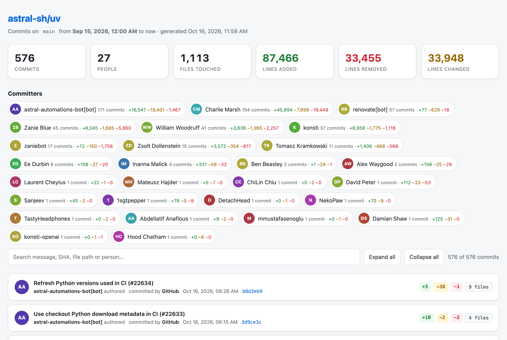
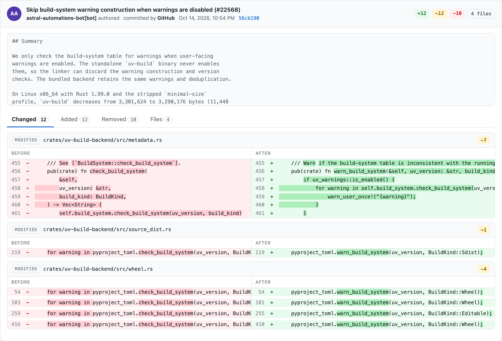
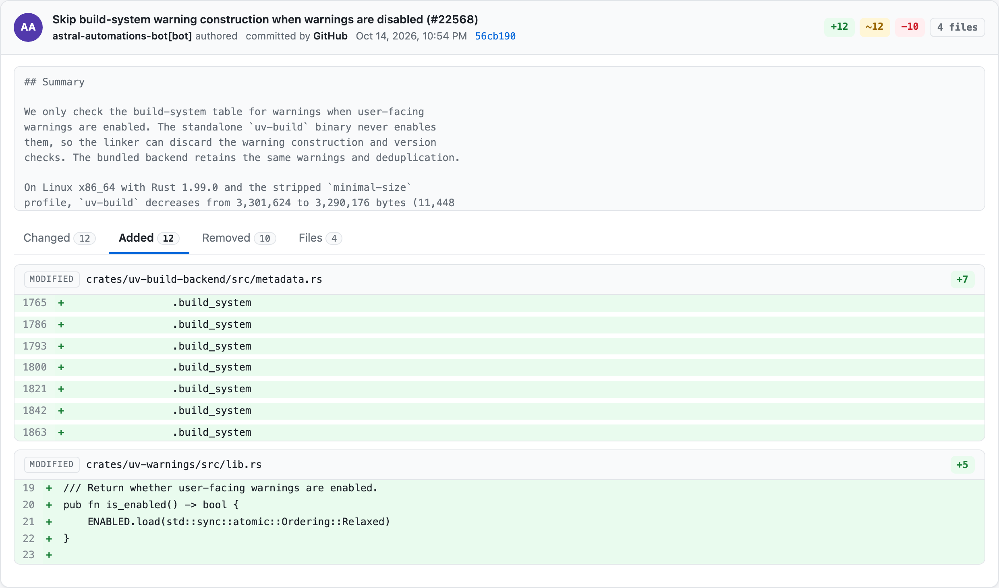

# github-commit-diff

See every commit on a GitHub repo's `main` branch since a given date: what was **added**, **removed** and **changed**, and **who** made each change. It's all in one interactive HTML report.

<picture>
  <source media="(prefers-color-scheme: dark)" srcset="docs/screenshots/overview-dark.png">
  
</picture>

### Changed lines, side by side, with the changed words highlighted

<picture>
  <source media="(prefers-color-scheme: dark)" srcset="docs/screenshots/changed-dark.png">
  
</picture>

### Added and removed lines, grouped by file

<picture>
  <source media="(prefers-color-scheme: dark)" srcset="docs/screenshots/added-dark.png">
  
</picture>

<sub>Screenshots: report for <a href="https://github.com/astral-sh/uv">astral-sh/uv</a> since 2026-09-15.</sub>

## Features

- **Stats at a glance:** commits, people, files touched, and lines added, removed and changed
- **Per-person breakdown:** click a person to show only their commits
- **Per-commit tabs:**
  - **Changed:** before and after side by side, with the changed words highlighted
  - **Added** and **Removed:** grouped by file, with line numbers
  - **Files:** each file marked as added, modified, deleted or renamed
- **Search** by commit message, SHA, file path or person
- **Light and dark mode** follow your system setting
- **No dependencies:** only Python 3.8+ and `git`

## Usage

```bash
python3 commit_diff.py <repo> <since> [-b BRANCH] [-o OUT.html] [--no-open]
```

```bash
python3 commit_diff.py https://github.com/psf/requests 2026-07-01
python3 commit_diff.py psf/requests 2026-07-01
python3 commit_diff.py owner/repo 2026-09-01T09:00 -b develop -o report.html
python3 commit_diff.py            # prompts for repo and date
```

| Argument | Description |
| --- | --- |
| `repo` | `https://github.com/owner/name`, `git@github.com:owner/name.git`, or `owner/name` |
| `since` | `YYYY-MM-DD` or `YYYY-MM-DDTHH:MM`; includes commits from then until now |
| `-b, --branch` | Branch to read (default `main`) |
| `-o, --out` | Output file (default `./commits-<owner>-<repo>-since-<date>.html`) |
| `--no-open` | Don't open the report in a browser |

Private repositories work if your local git credentials can clone them.

## How it works

1. The script does a shallow, single-branch clone of only the history after `since`, into a temporary directory.
2. It fetches one extra commit, so the oldest commit is compared with its real parent.
3. It parses `git log -p --unified=0` and sorts each run of removed and added lines into three groups:
   - **changed:** removed lines paired with the added lines that replaced them, in order
   - **added:** leftover added lines
   - **removed:** leftover removed lines
4. Changed pairs get word-level highlighting.
5. The data is embedded in a single self-contained HTML file.

**Notes:**
- Each commit shows its **author**. It also shows the **committer** when that's someone else, for example `GitHub` on PRs merged in the web UI.
- Each file shows at most 400 lines per tab. To change this, edit `MAX_LINES`.
- Merge commits are listed without their own changes.

## License

[MIT](LICENSE)
